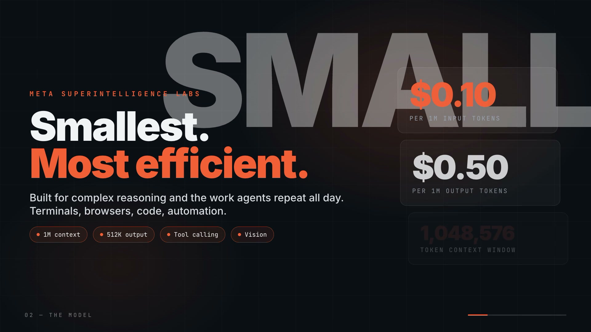

# Muse Ember demo

[](https://youtu.be/X6HGVitvS8I)

[](https://youtu.be/X6HGVitvS8I)

A motion graphics demo video made with Muse Ember (via OpenRouter) for the Build Day: OpenRouter × Meta hackathon.

- **Demo video**: https://youtu.be/X6HGVitvS8I
- **Local file**: `renders/muse-ember-demo.mp4` (60s, 1920×1080, H.264 with audio)
- **Brief**: https://app.notion.com/p/openrouter/Build-Day-OpenRouter-x-Meta-4102fd57c4dc808da9c8eaa351d460ad

## What it is

A HyperFrames composition from HeyGen, HTML, CSS and seekable GSAP animations that render to MP4.

Stack: HyperFrames from HeyGen (rendering) + GSAP (animation) + ElevenLabs (voiceover) + Muse Ember via OpenRouter (model).

Built with HyperFrames from HeyGen and ElevenLabs for voice. The video was directed, built, rendered and shipped by Muse Ember via OpenRouter.

- Entry: `index.html` (1920×1080, 60s, 6 scenes)
- Stack: HyperFrames from HeyGen 0.9.28, GSAP 3.15.0
- Voiceover: ElevenLabs text-to-speech, Burt Reynolds voice (`assets/vo.mp3`)
- Watch: https://youtu.be/X6HGVitvS8I

## Run

```bash
bunx hyperframes check
bunx hyperframes render -o renders/muse-ember-demo.mp4
```

## Model

All sessions run on `meta/muse-ember` through OpenRouter (see `.claude/settings.local.json`).

Sign-off: Karl Villanueva
